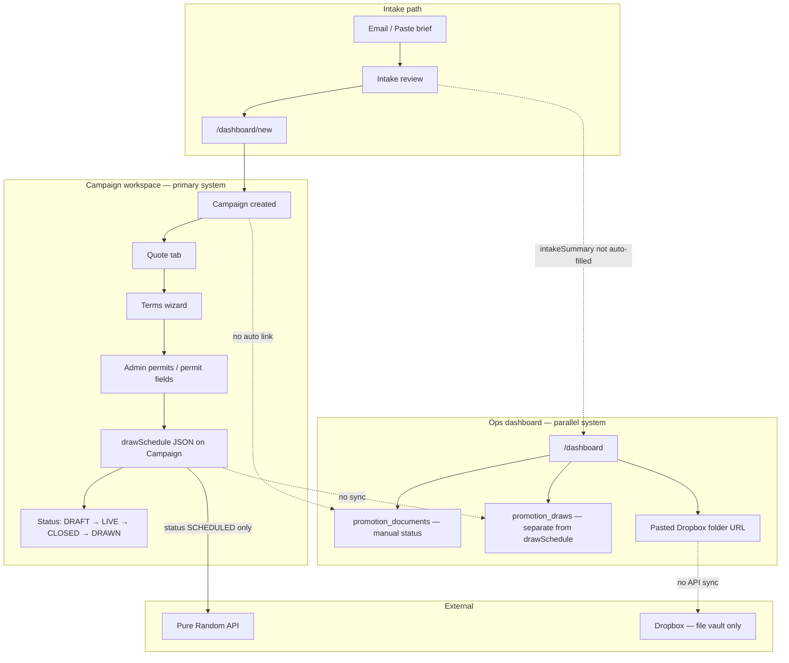

# Turnstyle — Project Overview & Workflow Assessment

**Purpose of this document:** Help Flow Marketing assess what Turnstyle actually does today, where the real workflow breaks down, and why the recent “Promotion Ops Dashboard” feels illustrative rather than operational.

**Last updated:** June 2026  
**Codebase:** `turnstyle/` (Next.js 16, Prisma, PostgreSQL)

---

## 1. Executive summary

Turnstyle is **not one system**. It is **several partially built tools** that share a database but do not share a single workflow:

| Layer | What it is | Practical for daily ops? |
|-------|------------|--------------------------|
| **Campaign builder** | Create campaigns, quotes, terms, permits, draw schedule JSON | **Partially** — strongest area for pre-launch work |
| **Pure Random integration** | Schedule draws via external API when status → SCHEDULED | **Partially** — works for draw scheduling, not file/cert workflow |
| **Intake** | Paste/email brief → review → prefill builder | **Partially** — stops at builder; no link to live job tracking |
| **Preflight** | Terms validation (campaign-linked or standalone upload) | **Useful** as a checker, not wired into ops obligations |
| **Ops dashboard** (`/dashboard`, `/dashboard/promotions`) | Manual checklist + draw tracker + Dropbox URL paste | **No** — duplicate data entry, no automation, disconnected from builder |

**Bottom line:** You can build a campaign and generate terms/quotes in Turnstyle. You **cannot** run a live promotion end-to-end from one place without re-entering status in a second UI that does not sync with the first.

Dropbox remains external. Turnstyle ops tables are a **parallel shadow ledger**, not the control layer.

---

## 2. Intended vs actual workflow

### What Flow Marketing actually needs

```
Brief → Quote → Invoice → Terms → Permits → Launch → Entry files → Draws → Certificates → Winner notify → Publication → Close
         ↓                                    ↓              ↓              ↓
      Dropbox folders hold the real files; Turnstyle should track what's due, what's missing, and where the file lives.
```

### What Turnstyle does today



**Critical gap:** Two sources of truth for draws (`Campaign.drawSchedule` vs `promotion_draws`) and documents (quote/terms/permit state on `Campaign` vs manual rows in `promotion_documents`).

---

## 3. Module inventory

### 3.1 Campaign builder & workspace (`/dashboard/[id]`)

**Maturity: Medium — most complete feature set**

| Capability | Status | Notes |
|------------|--------|-------|
| Create campaign | ✅ | `/dashboard/new`, `/dashboard/devflow` |
| Quote generation | ✅ | `lib/quote-engine.ts`, accept flow |
| Terms wizard | ✅ | Template gaps, comments, approval |
| Abbrev terms, LOA | ✅ | Separate routes |
| Prize / draw wizards | ✅ | Writes to `Campaign` JSON fields |
| Lifecycle bar | ✅ | DRAFT → ARCHIVED with gated transitions |
| Permit fields | ✅ | NSW/SA/ACT on campaign + admin permits page |
| Draw schedule | ✅ | JSON array on `Campaign.drawSchedule` |
| Winners tab | ⚠️ Stub | Placeholder UI |
| History / audit | ✅ | Audit logs exist |

**Real-world friction:**
- Large monolithic page (~1,500 lines) — powerful but heavy
- Status model is **compiler/review oriented** (DRAFT, COMPILED, REVIEW), not **operations oriented** (invoice issued, entry file received)
- No invoice paid/issued tracking in workspace (only quote accepted)
- No Dropbox integration in workspace

---

### 3.2 Pure Random draw machine

**Maturity: Medium for scheduling only**

| Capability | Status | Notes |
|------------|--------|-------|
| Schedule draws on SCHEDULED | ✅ | `lib/purerandom.ts`, status API |
| Upload link per draw | ✅ | `DrawScheduleTab`, upload-link API |
| Dataset uploaded gate | ✅ | `drawDatasetUploadedAt` |
| Winners confirmed gate | ✅ | `winnersConfirmedAt` |
| Draw certificates | ❌ | Not in Turnstyle |
| Certificate → Dropbox | ❌ | Not implemented |
| Ops draw obligations | ❌ | Lives in separate `promotion_draws` table, not synced |

Pure Random is integrated at **lifecycle transition**, not at **daily ops queue** level.

---

### 3.3 Campaign intake

**Maturity: Medium for capture, zero for ops**

| Capability | Status | Notes |
|------------|--------|-------|
| Paste brief | ✅ | `/dashboard/intake` |
| AI/heuristic extract | ✅ | `/api/intake/interpret` |
| Email inbound (Resend) | ✅ | Webhook + draft token |
| Prefill builder | ✅ | sessionStorage → `/dashboard/new` |
| Link intake → campaign record | ❌ | `CampaignIntakeDraft` never joins `Campaign` |
| Auto-fill `intakeSummary` on campaign | ❌ | Manual/seed only |

Intake helps **start** a job. It does not **track** the job.

---

### 3.4 Preflight

**Maturity: Medium as standalone validator**

| Capability | Status | Notes |
|------------|--------|-------|
| Campaign-linked preflight | ✅ | From terms wizard |
| Standalone .docx upload | ✅ | `/dashboard/preflight` |
| Score + report | ✅ | |
| Write score to campaign ops | ❌ | `preflightScore` exists but not auto-updated |
| Block launch if preflight fails | ❌ | Informational only |

---

### 3.5 Promotion ops dashboard (recent MVP)

**Maturity: Low — demo / shadow ledger**

| Capability | Status | Notes |
|------------|--------|-------|
| Sidebar nav | ✅ | Dashboard, Promotions, Draws, Overdue, Settings |
| Metric cards | ⚠️ | Counts from manual/seed data |
| Promotion list | ⚠️ | Reads campaigns but ops fields often empty |
| Document checklist | ⚠️ | 14 doc types — **all manual** dropdowns |
| Draw obligations | ⚠️ | **Separate table**, not synced from `drawSchedule` |
| Dropbox folder URL | ⚠️ | Paste only; no folder creation, no file detection |
| Launch readiness gate | ⚠️ | Logic exists but inputs are manually maintained |
| Invoice status | ⚠️ | `invoiceOpsStatus` enum — not tied to Xero/accounting or quote |
| Filter/sort documents | ❌ | Logic in `lib/ops/queries.ts`, no UI |
| Tasks / assignments | ❌ | No owner, no due-date reminders |
| Notifications | ❌ | No email/Slack on overdue |

**Why it feels like a trinket:**

1. **Double entry** — Draw dates live in campaign workspace *and* ops draws. Document status is not inferred from quote accepted, terms locked, or permit fields already on `Campaign`.
2. **Seed data masquerading as live ops** — Four example promotions make the dashboard look busy; real campaigns created via builder have empty ops rows until someone opens ops detail and init runs.
3. **No single “job record”** — Ops detail links *out* to campaign workspace for real work; ops tabs are a second place to click.
4. **Dropbox is a text field** — Cannot answer “where is the entry file?” unless someone pastes URLs by hand.
5. **Status theatre** — Calculated statuses (`DRAW_OVERDUE`, `READY_TO_LAUNCH`) depend on manually curated checklist rows, not system events.

---

## 4. Data model — where truth lives (and duplicates)

| Concern | Primary location | Ops duplicate | Synced? |
|---------|------------------|---------------|---------|
| Campaign identity | `Campaign` | — | — |
| Draw dates/times | `Campaign.drawSchedule` (JSON) | `promotion_drawer_draws` | **No** |
| Pure Random IDs | Inside `drawSchedule` JSON | `purerandomDrawStatus` on ops draw | **No** |
| Quote / invoice | `Quote`, quote status | `promotion_documents` + `invoiceOpsStatus` | **No** |
| Terms progress | `TermsDraft.status` | `draft_terms` / `final_terms` docs | **No** |
| Permits | `permitNSW/SA/ACT` on campaign | `permit_*` document rows | **No** |
| Intake brief | `CampaignIntakeDraft` | `Campaign.intakeSummary` | **No** |
| Files | Dropbox (external) | `dropboxFileUrl` per doc row | **Manual paste only** |
| Preflight | Report pages / JSON | `Campaign.preflightScore` | **No** |

Until one layer **derives** or **syncs** the other, ops dashboard will always feel clunky.

---

## 5. Navigation & UX fragmentation

Users currently face **multiple entry points** with overlapping purpose:

| URL | Role |
|-----|------|
| `/dashboard` | Ops home (new) |
| `/dashboard/promotions` | Ops list |
| `/dashboard/promotions/[id]` | Ops detail (tabs) |
| `/dashboard/[id]` | Campaign workspace (quotes, terms, draws) |
| `/dashboard/lite/[id]` | Draw-only simplified view |
| `/dashboard/devflow` | Alternate builder |
| `/dashboard/new` | Full builder |
| `/dashboard/intake` | Brief capture |
| `/dashboard/admin/permits` | Permit number entry |
| `/dashboard/preflight` | Standalone terms check |

There is **no canonical “open this job”** screen that combines ops obligations with builder actions.

---

## 6. What actually works for real work today

Use these **as-is**:

1. **New promotion setup** — Devflow or `/dashboard/new` after intake prefill  
2. **Quote** — Generate and accept in campaign workspace  
3. **Terms** — Wizard + client review link  
4. **Draw scheduling to Pure Random** — When campaign reaches SCHEDULED (if draw schedule confirmed)  
5. **Permit number capture** — Admin permits page when status is PENDING  

**Do not rely on for live ops:**

- Ops dashboard document checklists (unless team commits to manual discipline)  
- Ops draw calendar (until synced from `drawSchedule`)  
- Launch gate on ops overview (until invoice/terms/permit sync exists)  
- Dropbox folder structure display (labels only; folders not created)

---

## 7. Gap analysis vs your original ops spec

| Requirement | Built? | Practical? |
|-------------|--------|------------|
| One dashboard for live promotions | UI yes | No — data not wired |
| Dropbox = vault, Turnstyle = metadata | Concept yes | URLs manual only |
| 13-folder structure | Constants yes | Not created in Dropbox |
| Draw schedule with entry file / cert / notify / publication | Schema yes | Manual duplicate of draw JSON |
| File status system (11 statuses) | Enum + UI yes | All manual |
| Dashboard cards (draw files overdue, etc.) | Yes | Reflects seed/manual state |
| Invoice gate before launch | Logic yes | Not tied to real invoice |
| Filter/sort documents | Backend only | No UI |
| Seed promotions | Yes | Illustrative |
| Answer “what’s missing?” instantly | No | Requires prior manual entry |

---

## 8. Recommended direction (if the goal is practical ops)

Priority order — **integrate, don’t duplicate**:

### Phase A — Single job record (1–2 weeks)
- **One promotion detail page** — merge ops obligations into `/dashboard/[id]`, retire parallel ops detail or make it a read-only summary redirect.
- **Sync draws on write** — When `drawSchedule` saves, upsert `promotion_draws` automatically.
- **Derive document status** — Map existing signals:
  - Quote ACCEPTED → `quote_approved` COMPLETE  
  - TermsDraft LOCKED → `final_terms` COMPLETE  
  - `permitNSW` filled → update permit doc rows  
  - `drawDatasetUploadedAt` set → entry file RECEIVED  
- **Auto `intakeSummary`** when campaign created from intake draft.

### Phase B — Ops queue that saves time (1 week)
- **Home dashboard = computed queue**, not metric cards on empty fields:
  - Draws in next 7 days (from synced draws)  
  - Campaigns LIVE with missing entry file  
  - PENDING permit campaigns  
  - Quotes accepted but not SCHEDULED  
- Assignee + due date optional fields (who owns next action).

### Phase C — Dropbox MVP that helps (1–2 weeks)
- Paste parent folder URL (keep)  
- **Optional:** Dropbox API — list folder, suggest file match by name, store returned link  
- Do **not** store file bytes in Turnstyle.

### Phase D — Invoice reality (depends on billing stack)
- Either integrate Xero/accounting webhook **or** simplify to “quote accepted = invoice issued” until billing integration exists.

### What to stop doing
- Adding more manual status dropdowns without sync  
- Seed data on production  
- Building separate nav trees for the same campaign  

---

## 9. File map (quick reference)

```
turnstyle/
├── app/dashboard/
│   ├── (ops)/              ← Ops UI (dashboard, promotions, draws, overdue)
│   ├── [id]/               ← Campaign workspace (primary builder)
│   ├── new/, devflow/      ← Creation flows
│   ├── intake/             ← Brief capture
│   ├── preflight/          ← Standalone terms check
│   └── admin/permits/      ← Permit numbers
├── lib/
│   ├── ops/                ← Ops logic (status, metrics — underused)
│   ├── lifecycle.ts        ← Builder lifecycle steps
│   ├── purerandom.ts       ← Draw API client
│   ├── quote-engine.ts     ← Pricing
│   ├── intake/             ← Brief interpretation
│   └── preflight/          ← Terms validation
└── prisma/schema.prisma    ← Campaign + ops tables
```

**Note:** Repo root has an empty `app/dashboard/page.tsx` — not wired to Next.js app. Real app lives under `turnstyle/`.

---

## 10. Assessment checklist (use this to decide next build)

Answer honestly for a real client job (e.g. Repco):

- [ ] Can I open **one screen** and see quote, terms, permits, next draw, and overdue items?  
- [ ] When I confirm draws in the builder, does the draw calendar update **without** re-entry?  
- [ ] When the client pays, does invoice status update **without** a separate dropdown?  
- [ ] When Pure Random completes a draw, does certificate status advance?  
- [ ] Can I click through to the Dropbox file **without** hunting for a pasted URL?  
- [ ] Did intake from email attach to this campaign automatically?  

**Today: mostly no.** That is why the ops dashboard is illustrative, not operational.

---

## 11. Suggested decision

**Option 1 — Fold ops into campaign workspace**  
Best if Turnstyle stays an internal Flow tool. One record, derived statuses, draw sync, ops tab on existing `[id]` page.

**Option 2 — Pause ops UI; fix builder lifecycle first**  
Best if pre-launch (quote/terms/permit) is the pain point. Add invoice + permit gates to existing lifecycle; defer Dropbox.

**Option 3 — Lightweight external ops (Notion/Airtable) + Turnstyle for terms/draws only**  
Pragmatic if build time is limited. Turnstyle does what it’s good at; ops tracking elsewhere until sync is worth building.

---

*This overview is intentionally critical. The codebase has strong pieces (terms engine, quote engine, Pure Random hook, intake). The ops layer added a second app on top without integration — that is the clunkiness you are feeling.*
